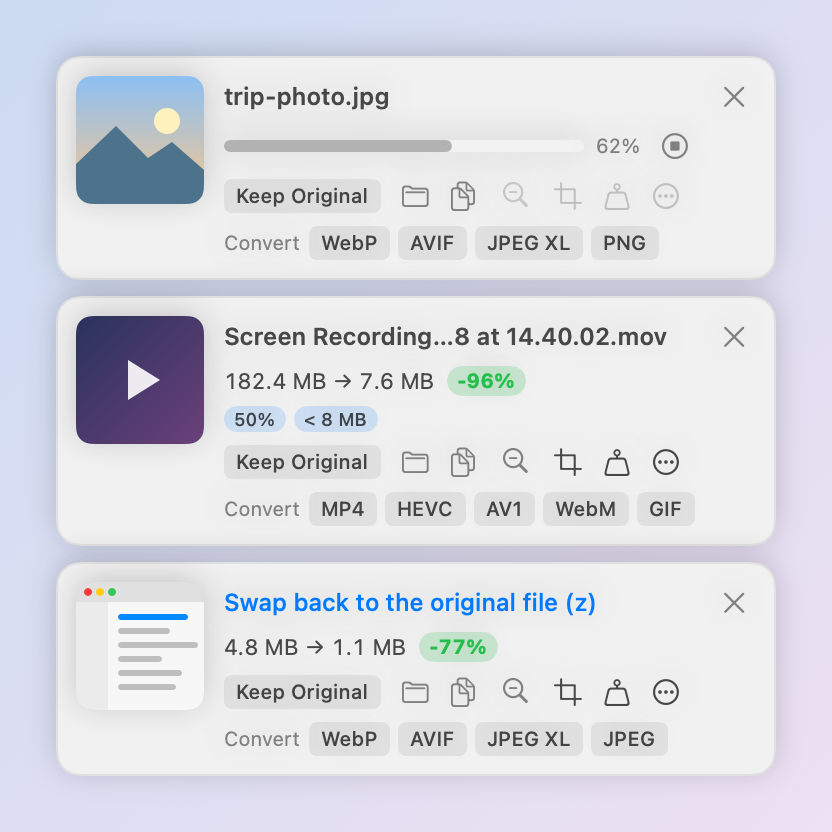
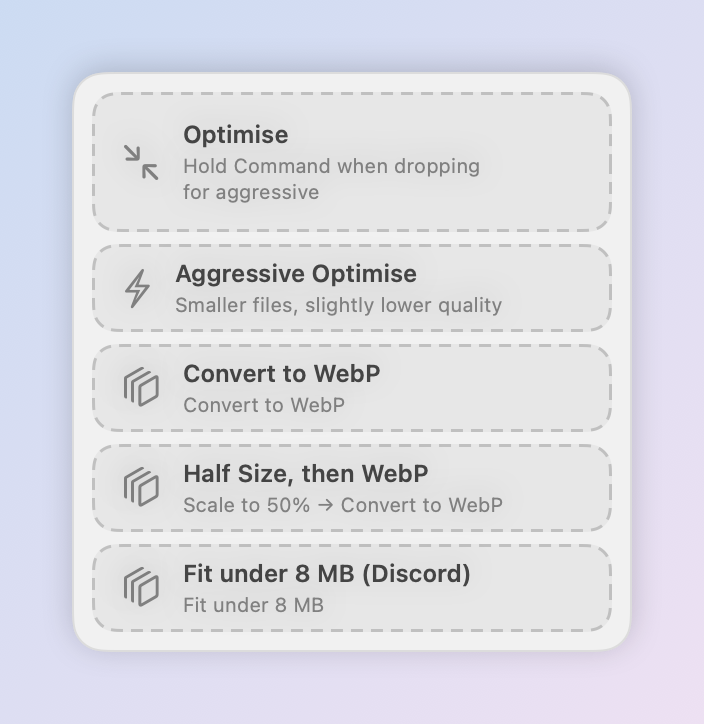
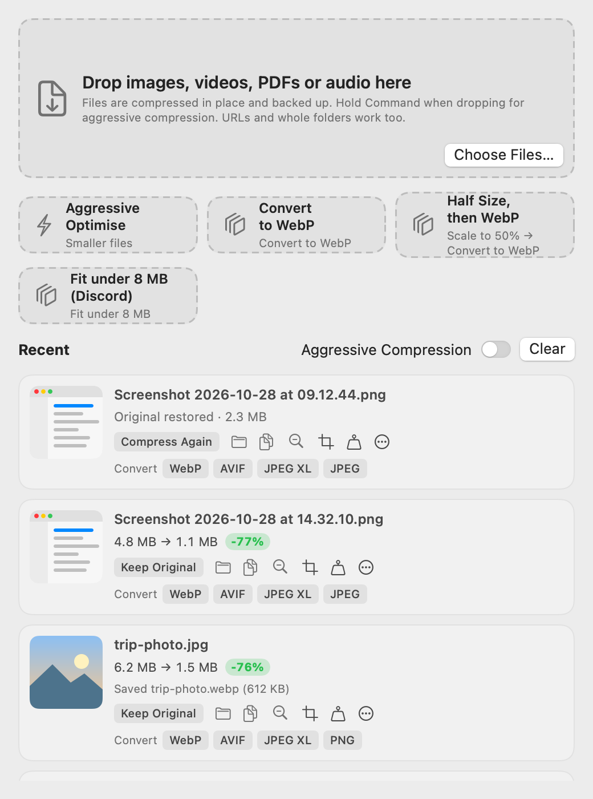

# SmallImg

A menu bar app for macOS that compresses images, videos, PDFs and audio. Everything runs locally on your Mac. Nothing is uploaded.

Screenshots and screen recordings are compressed automatically as soon as they land on your Desktop, and a small result card pops up in the corner so you can undo, resize, crop or convert in one click.

> The interface follows your system language: English, or Traditional Chinese when Chinese is your preferred language. Hover over any button on the result card to see what it does.

## How it works

### 1. Take a screenshot or a screen recording

Press `Cmd+Shift+4` (or record with `Cmd+Shift+5`) as usual. SmallImg notices the new file, compresses it in place and shows a result card in the bottom-right corner of the screen.



Each card shows the size before and after. From the card you can:

- **Keep Original**: throw away the compressed version and put the untouched original back. Compression is the default, so this is the one click you need when you want the full-quality file
- Reveal in Finder, copy, downscale, crop, fit under a file size, or open the `...` menu for aggressive compression, watermarks and pipelines
- **Convert**: save a copy as WebP, AVIF, JPEG XL, MP4, HEVC, AV1, WebM, GIF and more
- Drag the thumbnail straight into a chat app or browser upload field

Hovering a button replaces the file name with a short description of what the button does. The card disappears on its own after a few seconds unless your mouse is over it.

### 2. Drag files in

Start dragging any image, video, PDF or audio file and a drop zone slides in. Drop on **Optimise** to compress, **Aggressive Optimise** for smaller files at slightly lower quality, or on one of your pipelines (convert to WebP, halve the size, fit under 8 MB, ...).



### 3. Review everything in the main window

Click the menu bar icon and choose **Open Compression Window** (or press `Cmd+O` in the menu) to open the main window. It has a large drop target and a history of recent files. A file you restored shows **Compress Again** so you can change your mind either way.



## Requirements

- macOS 14 (Sonoma) or later
- [Homebrew](https://brew.sh) for the compression tools:

```sh
brew install pngquant jpegoptim gifsicle gifski ghostscript jpeg-xl libavif webp ffmpeg
```

## Install

### Option A: download the app

1. Download `SmallImg.zip` from the [latest release](../../releases/latest) and unzip it.
2. Move `SmallImg.app` to `/Applications`.
3. The app is not notarized, so macOS will block it the first time. Remove the quarantine flag:

   ```sh
   xattr -dr com.apple.quarantine /Applications/SmallImg.app
   ```

4. Open the app. When it asks for access to your Desktop, click **Allow** so screenshots can be compressed automatically.

The release build is for Apple Silicon. On an Intel Mac, build from source.

### Option B: build from source

Requires Xcode Command Line Tools (`xcode-select --install`).

```sh
git clone https://github.com/ZilongRRR/small-img.git
cd small-img
./build.sh
```

`build.sh` compiles a release build, installs it to `/Applications` (or `~/Applications`), links the `smallimg` command line tool and launches the app.

## Features

- **Automatic compression** of new screenshots, screen recordings and images copied to the clipboard
- **Keep Original**: every result card has a button that swaps the compressed file back to the untouched original. Compression stays on by default
- **Result card actions**: restore, downscale (`-` or `1`-`9` for 10%-90%), crop, fit under a file size (8 MB for Discord, 25 MB for Gmail, or custom), speed, mute, loudness normalisation, watermark
- **Convert** to WebP, AVIF, JPEG XL, HEVC, AV1, WebM, GIF, MP3 or AAC (hold Option to keep the previous conversion)
- **Drop zone**: drag files anywhere and a drop zone appears. Hold Command when dropping for aggressive compression
- **Pipelines**: chain steps and attach them to the drop zone, screenshots, clipboard, watched folders, the Finder Services menu or the command line
- **Batch window** opens automatically for more than 30 files
- **PDF** compression and margin cropping to fit a device's aspect ratio
- **Finder**: press Control-O to compress the selected files, or use the right-click Services menu
- **Clipboard**: Control-Shift-C compresses the image on the clipboard on demand

Originals are backed up to `~/Library/Application Support/SmallImg/Backups`, so every change can be undone.

### Result card shortcuts

| Key | Action |
| --- | --- |
| `-` | Downscale one step |
| `1`-`9` | Scale to 10%-90% |
| `z` | Restore the original |
| `c` | Copy |
| `x` / Esc | Dismiss |
| Space | Open |

## Command line

```sh
smallimg optimise --fit 8MB video.mov
smallimg convert --to webp *.png
smallimg crop-pdf --for-device "iPad Air" book.pdf
smallimg pipeline "<pipeline name>" image.png
smallimg restore image.png
smallimg tools      # check that all compression tools are installed
smallimg help
```

## Privacy

All processing happens on your machine using the open source tools listed above. SmallImg makes no network requests except when you drop a URL onto it, in which case it downloads that file.
## License

[MIT](LICENSE)
